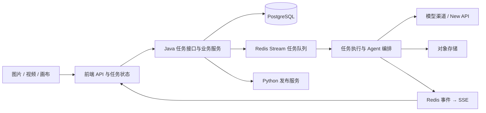

# baotuo-studio 项目分析与改造记录

日期：2026-11-01。

后续变更：已移除捆绑 New API 部署，后台支持自定义直连渠道；以下初次分析中的网关现状已被 [模型直连配置](custom-model-channels.md) 取代。目标：建立独立产品品牌，优化界面体验，逐步重构代码架构。

本记录来自源码静态分析。尚未启动完整服务、连接数据库或调用模型，不把静态发现当作已验证的运行故障。本轮完成品牌及工作台基础改造；画布和后端大型业务模块的拆分仍待实施。

## 1. 项目现状

这是完整的 AI 视觉创作平台。已有图片生成、视频生成、无限画布、分镜/短剧、电商创作、素材库、提示词库、账号、积分支付和多平台发布。优先复用已有能力，围绕用户的创作流程改造。

| 目录 | 实际技术及职责 | 改造方式 |
| --- | --- | --- |
| `web/` | Next.js 16.2.3、React 19.2.5、TypeScript、Zustand、Ant Design、Tailwind、React Flow | 保留框架，业务归入 features，统一品牌和导航 |
| `server/` | Java 21、Spring Boot 3.5.15、WebFlux、R2DBC、AgentScope | 按业务职责逐步拆分，保留接口兼容 |
| `newapi/` | New API 网关插件、Node 媒体辅助服务 | 模型供应商差异集中在适配层 |
| `publisher-service/` | Python FastAPI、Playwright，附带第三方发布适配代码 | 保持独立部署，避免浏览器自动化进入主后端 |
| PostgreSQL / Redis | 业务持久化、Redis Stream 任务队列和任务事件 | 保留任务恢复、幂等和事件语义 |
| Nginx / Docker Compose | 页面、API、SSE 代理及服务编排 | 联调时验证 SSE 不缓冲和媒体请求 |

初次扫描：`web/src` 中 623 个 TS/TSX/CSS 文件，约 9.3 万行（含测试）；Java 主源码 298 个文件，约 6.2 万行。行数用于定位阅读重点，不代表性能或代码质量评分。

## 2. 核心调用链



`AiTaskController` 对外提供创建、查询、取消任务和订阅接口；`AiTaskQueue` 将任务 ID 写入 Redis Stream，执行时读取数据库快照；`AiTaskEventPublisher` 将 Redis 事件转发给当前实例的用户订阅者。因此画布重构必须兼顾前端交互、后端任务生命周期和断线恢复。

## 3. 主要改造点

| 位置 | 已确认的现状 | 建议 |
| --- | --- | --- |
| `web/src/features/canvas/pages/canvas-client-page.tsx` | 6,936 行，连接画布编辑、分镜、生成、素材、Agent 与视频合成 | 按编辑状态、任务执行、工作区持久化、分镜编排拆分，优先复用现有 domain/hooks |
| `web/src/app/(user)/video/page.tsx` | 2,718 行 | 将业务移入 video feature，路由负责组装 |
| `web/src/app/(user)/image/page.tsx` | 1,696 行 | 提取生成会话和参数管理；与视频共用底层任务能力 |
| `web/src/services/api/server.ts` | 1,650 行，混合支付、发布、模型、素材、任务、认证与缓存 | 先分离 HTTP 行为和业务缓存，再按业务拆分，保留旧导出兼容迁移 |
| `PersistenceService.java` | 2,461 行，同时管理渠道、模型、项目、素材、记录与上传 | 拆为模型目录、工作区持久化、媒体管理三个明确模块，保持事务边界 |
| `CreationAgentOrchestrator.java` | 2,527 行 | 区分计划生成、计划执行和恢复，避免页面了解内部步骤 |
| `web/next.config.ts` | `ignoreBuildErrors: true` | 先建立类型错误基线，按模块修复，再恢复构建门禁 |
| 迁移文档 | 服务端 README 称只有 V1；实际存在 V1–V65 文件，部分导入脚本为空注释 | 新库实测迁移，已有库逐项比对历史；不能按 README 直接判断兼容性 |

不是所有大文件都应按行数拆开。每个模块应对调用方隐藏完整的行为，例如任务订阅、取消、重连及结果归并，避免只把代码搬到需要大量参数的 Hook 中。

## 4. 本轮已实施

### 品牌

- 前端品牌单一入口：`web/src/shared/config/brand.ts`。
- 后端对客品牌单一入口：`server/src/main/java/com/inspirestudio/common/ProductBrand.java`。前后端独立构建，当前各自保留一个定义。
- 更新页面元信息、导航、登录页、欢迎页、积分店铺标题、后台新内容的默认作者名。
- 新增 B 字形 SVG 标识、PNG Apple 图标，并替换 favicon。
- 登录/密码重置邮件、新支付订单描述、对象存储测试文案使用新品牌。邮件标记使用 HTML 字符，不再请求上游站点的品牌图片。
- `/editions` 地址保留，内容改为本项目的工作台介绍，不再展示上游的企业版本销售承诺。
- 现有数据库中的历史订单、素材作者及第三方来源署名不做批量改写。

### 界面

- 桌面端采用 208px 分组导航，明确显示创作、资源、设置及完整功能名称。
- 768–1199px 使用 80px 紧凑导航，更窄屏幕继续使用抽屉。
- 顶栏增加当前位置，统一品牌字标和按钮间距。
- 保留现有深浅主题、画布专注模式、键盘焦点和减少动画偏好。
- 首页文案围绕“让灵感成为作品”，保留已有创作入口和作品展示。

### 架构

- 首页实现迁移到 `web/src/features/homepage/pages/homepage.tsx`；首页路由缩为组装入口。
- 导航路径匹配收敛到 `web/src/features/app-shell/lib/workspace-route.ts`，桌面和顶栏共用，移动端接收相同结果。覆盖嵌套路由、管理页归属、前缀冲突和最长匹配。
- 新增 `pnpm typecheck`，类型检查与当前忽略类型错误的构建行为明确区分。

## 5. 后续实施顺序

1. **建立运行基线**：恢复依赖安装，在隔离的新数据库启动完整服务；记录类型检查、构建、前后端现有测试结果。对比 390px、1024px、1440px 的深浅主题页面。
2. **整理生成模块**：先拆 HTTP 传输和业务 API；保留 401 登录处理、请求取消、Retry-After、上传下载、缓存失效和 SSE 行为。以图片生成链路为第一条迁移路径。
3. **重构画布**：明确“编辑文档”和“运行中的任务”两类状态。页面离开不能隐式取消云端任务；显式停止才取消。保留撤销重做、草稿恢复和分镜连续性。
4. **拆分后端业务模块**：首先拆 `PersistenceService` 的模型配置、工作区、媒体职责；再处理 Agent 的计划与执行。每次迁移一个职责，保留现有 API。
5. **统一创作界面**：图片/视频采用一致的参数区、输入区、结果区和任务状态；素材选择、错误重试、空状态与加载状态复用。
6. **上线前检查**：在具备真实配置的环境验证生成失败/退款、支付幂等、断线恢复、对象存储和发布流程。

验收应关注完整行为：同一笔任务不会重复扣费；取消、重试和重连后状态正确；切页不丢草稿；新旧项目能读取；管理员与普通用户的功能权限一致。当前没有性能测量，不能承诺帧率或加载速度提升。

## 6. 验证记录与环境限制

- 新增导航测试 3 项通过；现有主题偏好测试 6 项通过。
- 使用临时 Java 校验程序编译品牌常量及从源码提取的两种邮件模板，验证格式化成功、新品牌正确、重置链接与验证码仍保留；这不等同完整服务端测试。
- 本轮 13 个前端 TS/TSX 文件通过 TypeScript 转译语法检查；2 个导航 CSS 文件通过 PostCSS 解析。语法检查不等同完整类型检查。
- 首页展示和应用主题两组测试启动失败：缺少 `zustand` 和 `antd` 依赖，未获得有效测试结果。
- `pnpm install --frozen-lockfile` 首次受到默认缓存写入限制；改用 `/private/tmp` 缓存后下载被 DNS 错误 `ENOTFOUND registry.npmjs.org` 阻断。
- 本机没有 Maven 命令，源码也没有 Maven Wrapper；完整 Java 编译和服务端测试未执行。
- 未完成 Next.js 构建、浏览器截图验证、数据库迁移或真实模型调用。

依赖恢复后执行：

```sh
cd web
pnpm install --frozen-lockfile
pnpm typecheck
pnpm build
pnpm test:node src/features/app-shell/lib/workspace-route.test.ts src/shared/lib/theme-preference.test.ts src/shared/lib/app-theme.test.ts src/features/homepage/api/homepage-showcases.test.ts
```

随后在 Java 21 与 Maven 环境中运行服务端测试及新库启动检查。

## 7. 源码与许可记录

初始 README 标注 MIT，但根目录 LICENSE 是 GNU AGPL v3 文本，两者冲突。本轮保留 LICENSE，README 如实记录差异，不把重命名当作重新授权。第三方实现及示例作品的原始署名继续保留。

当前目录未发现 `.git`，应视作源码快照；本轮没有创建提交或发布部署。
